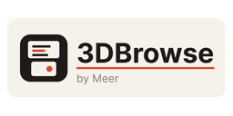
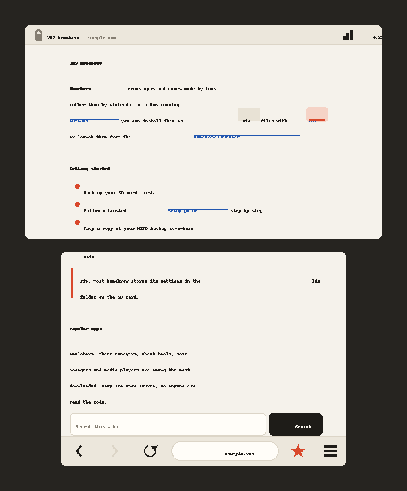
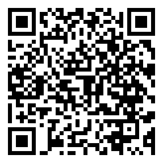

<div align="center">



# 3DBrowse

**A fast, text-first web browser for the Nintendo 3DS**

One page across both screens · tap links · search, forms and logins · bookmarks · dark mode

[](https://github.com/meerok/Meer_3DBrowse/actions/workflows/build.yml)
[](https://github.com/meerok/Meer_3DBrowse/releases/latest)



</div>

---

## Install

### QR code (fastest)

On your 3DS open **FBI > Remote Install > Scan QR Code** and point the camera at this:



### Manual

1. Download `3DBrowse.cia` from the [latest release](https://github.com/meerok/Meer_3DBrowse/releases/latest).
2. Copy it to your SD card.
3. Open FBI, find the file and choose **Install CIA**.

3DBrowse then shows up on your HOME Menu.

### Homebrew Launcher (.3dsx)

1. Download `3DBrowse.3dsx` from the [latest release](https://github.com/meerok/Meer_3DBrowse/releases/latest).
2. Copy it to `sdmc:/3ds/` on your SD card.
3. Open the Homebrew Launcher and pick 3DBrowse.

> **You need** a 3DS with custom firmware (Luma3DS) and a Wi-Fi connection set up in System Settings.

---

## Why it's fast and stable

The built-in 3DS browser tries to be a full desktop browser on 2011 hardware. 3DBrowse doesn't. It reads the page's HTML and lays it out as clean, readable text in one pass, without building a DOM, running scripts or downloading stylesheets and images.

- **Never freezes while loading.** Pages download and get laid out on a background thread. The UI keeps drawing at 60 fps and **B** cancels at any time.
- **Instant back and forward.** The last few pages are kept in memory, so going back doesn't reload them.
- **Can't run out of memory.** Every buffer has a hard limit. A page that's too big is cut off with a notice instead of crashing the app.
- **Reuses connections.** One HTTP session stays open between pages on the same site, so following links skips the slow TLS handshake.
- **Only draws what you can see.** Text near the screen is prepared once and reused while you scroll.

## Features

| | |
|---|---|
| 📖 **Both screens** | The page runs down the top screen and continues onto the touch screen, so you can tap links directly |
| 🔎 **Search** | Type anything in the address bar to search DuckDuckGo, or enter a web address |
| 📝 **Forms and logins** | Text boxes, passwords, checkboxes, drop-downs and buttons work with GET and POST. Cookies are saved between sessions |
| ⭐ **Bookmarks and history** | Star a page from the toolbar. Bookmarks and recent pages show on the start page |
| 📰 **Reader view** | Sends the current article through FrogFind for a clean, ad-free version |
| 🌙 **Light and dark** | A warm paper theme and a dark ink theme |
| 🔠 **Text size** | Small, medium or large. The page reflows straight away |
| 🔒 **HTTPS** | Certificates are checked against a bundled set of trusted roots |

### What it doesn't do

3DBrowse doesn't run JavaScript, apply CSS layouts or show pictures (an image's description is shown in its place). Sites built entirely in JavaScript, like YouTube or most web apps, won't work. News sites, Wikipedia, forums, blogs, documentation and search work well. If a site looks messy, try **Reader view** from the menu.

## Controls

| Button | Action |
|---|---|
| Circle Pad / C-Stick | Scroll |
| D-Pad ▲ ▼ | Pick the previous / next link or field |
| D-Pad ◀ ▶ | Page up / down |
| A | Open the link or edit the field you picked |
| B | Stop loading, or go back |
| L / R | Back / forward |
| ZL / ZR | Top / bottom of the page |
| Y | Address bar |
| X | Menu |
| SELECT | Bookmarks |
| START | Exit |
| Touch | Tap links, fields and toolbar buttons. Drag to scroll, flick to coast |

### Toolbar

`‹` back · `›` forward · `⟳` reload (becomes `×` to stop while loading) · address pill (tap to type) · `★` bookmark · `≡` menu

## Files on your SD card

| File | What it is |
|---|---|
| `/3ds/3DBrowse/bookmarks.txt` | Your bookmarks, one `URL<tab>Title` per line |
| `/3ds/3DBrowse/history.txt` | Recently visited pages |
| `/3ds/3DBrowse/cookies.txt` | Saved logins. Clear them from the menu |
| `/3ds/3DBrowse/settings.txt` | Text size, theme and certificate checks |

## Reporting a crash

If 3DBrowse crashes, take a photo of the Luma3DS crash screen and open an issue with the address of the page you were on. You can also run the **Look up crash address** workflow from the Actions tab with the **PC** and **LR** values to see exactly where it happened.

---

## Building from source

Every push to `main` is built by GitHub Actions, which publishes `3DBrowse.cia` and `3DBrowse.3dsx` to the latest release.

To build on your own computer:

1. Install [devkitPro](https://devkitpro.org/wiki/Getting_Started) with the 3DS tools.
2. Install the libraries:
   ```
   sudo dkp-pacman -S 3ds-dev 3ds-curl 3ds-mbedtls 3ds-zlib
   ```
3. Put [makerom](https://github.com/3DSGuy/Project_CTR/releases) and [bannertool](https://github.com/diasurgical/bannertool/releases) on your PATH.
4. Download the root certificates: `curl -o romfs/cacert.pem https://curl.se/ca/cacert.pem`
5. Generate the artwork with `make assets` (needs Python 3 with Pillow and qrcode).
6. Run `make cia`.

### How the code is laid out

| File | What it does |
|---|---|
| `source/html.c` | The page engine: a forgiving HTML tokenizer feeding a line-breaking layout engine. No 3DS code, so it can be tested on a PC |
| `source/net.c` | Background loading with libcurl, cookies, redirects and HTTPS |
| `source/main.c` | Drawing with citro2d, input, navigation, forms and the menu |
| `source/url.c` | Resolving relative links and turning typed text into a URL or search |
| `source/store.c` | Bookmarks, history and settings |
| `source/pages.c` | The built-in start, bookmarks, history and about pages |
| `tools/preview_host.c` | Runs the page engine on a PC. `make assets` uses it to draw `preview.png` |

Built with libctru, citro2d, libcurl, mbedTLS and zlib.

## Credits

- Search: [DuckDuckGo Lite](https://lite.duckduckgo.com/lite/)
- Reader view: [FrogFind](http://frogfind.com/)
- Root certificates: [curl CA bundle](https://curl.se/docs/caextract.html) (from Mozilla)
- Made by **Meer**
